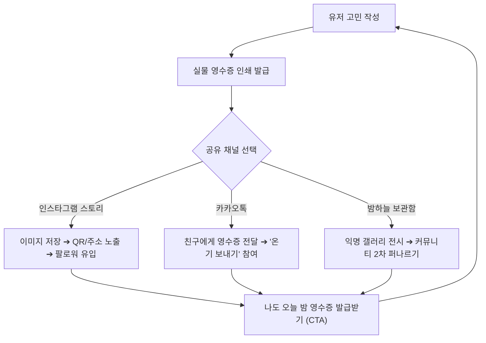

# ✧ 신비한 고민 상점의 영수증 - 바이럴 루프(Viral Loop) & 초기 성장 전략 가이드

> **대상 서비스**: 신비한 고민 상점의 영수증 (Mystic Worry Shop Receipt)  
> **핵심 과제**: 바이럴 루프 설계를 통한 초기 사용자 유입 및 오가닉 확산(Organic Spread) 가능성 분석  
> **작성 일자**: 2026년 10월

---

## 1. 성공 가능성 총평: "성공 잠재력 매우 높음 (High Potential)"

단순한 일회성 심리테스트를 넘어, **MZ세대의 힐링·자기이해 소비 트렌드**와 **SNS 공유에 가장 최적화된 시각적 폼팩터(영수증)**가 유기적으로 결합되어 있습니다.  
유료 광고비 집행 없이도 한 명의 유저가 1명 이상의 신규 유저를 데려오는 **바이럴 계수($K > 1$)**를 달성하기에 이상적인 구조입니다.

---

## 2. 왜 이 아이템이 바이럴에 강력한가? (3대 심리 트리거)

### ① 검증된 '영수증 폼팩터'의 시각적 파괴력
- **세로형 카드 비율(9:16)**: 인스타그램 스토리, 핀터레스트, 틱톡/릴스 등 모바일 피드에 잘림 없이 꽉 차게 들어맞습니다.
- **높은 완독률**: 텍스트가 길어도 "실제 영수증 종이"라는 익숙한 오브젝트 안에 담기면 사용자는 자연스럽게 품목 하나하나를 끝까지 정독하게 됩니다.
- **소비/성향 영수증의 흥행 계보**: '생각 과다 영수증', '빡침 영수증', '소비 영수증' 등 영수증 기반 콘텐츠는 이미 수백만 회 공유를 입증한 불패의 포맷입니다.

### ② "감정 청구 비용 0원 (대납 완료)"이 주는 강력한 카타르시스
- 기존 테스트들은 단순히 "당신은 이런 성향입니다"라는 진단으로 끝납니다.
- 본 서비스는 **"당신이 고민하느라 소모한 마음 에너지 780 kcal, 상점 주인이 전액 대납하여 0원 처리되었습니다"**라는 실질적인 **심리적 해방감(Emotional Catharsis)**을 선물합니다.
- 이 따뜻한 반전 포인트에서 유저들은 깊은 감동을 느끼며, **"나 위로받았다"는 자랑이자 치유의 의미로 자발적 공유**를 감행합니다.

### ③ 골든 아워(Golden Hour)와 타겟층의 완벽한 일치
- 취준생, 대학생, 사회초년생이 잠들기 전 잡생각과 불안에 시달리는 **새벽 11시 ~ 3시**에 가장 강력한 파괴력을 가집니다.
- "오늘 밤 당신의 짐은 이곳에 두고 가세요"라는 슬로건 자체가 새벽 감성을 정조준합니다.

---

## 3. 폭발적 확산을 만드는 3단계 바이럴 루프(Viral Loop) 아키텍처

### 🔁 Loop 1: 인스타그램 스토리 1초 저장 & 워터마크 루프
- **장치**: [영수증 이미지로 저장] 시, 영수증 최하단에 **"나도 마음의 짐 털어놓기 ➔ mystic-worry.shop"** 문구와 스캔 가능한 미니 QR코드가 자동으로 합성되어 저장됩니다.
- **유저 심리**: "나 요즘 이런 걸로 끙끙 앓았는데 위로받음", "내 마음 영수증 0원 실화냐 ㅠㅠ"
- **효과**: 팔로워들이 스토리를 보고 *"이거 어디서 해?"*를 물어볼 필요 없이 QR/주소로 즉각 유입됩니다.

### 🔁 Loop 2: 카카오톡 '온기(위로) 보내기' 친구 초대 루프
- 영수증 발급 후 카카오톡 공유 링크를 전송할 때, 일반 링크가 아닌 **'온기 배달 카드'**로 발송:
  > **💌 "지친 별빛 님이 신비한 고민 상점에 영수증을 남겼습니다. 친구의 마음에 따뜻한 온기(하트)를 보태어주세요!"**
- **상대방(친구)의 경험**:
  1. 링크를 열어 친구의 영수증과 처방전을 읽고 **[💛 온기 보내기]** 클릭 (하트 애니메이션 폭죽).
  2. 바로 아래에 대형 버튼 노출: **[🔮 나도 오늘 밤 고민 털어놓고 영수증 받기]**.
  3. 자연스럽게 다음 생산자(User)로 전환.

### 🔁 Loop 3: '밤하늘 보관함'을 통한 커뮤니티 2차 확산
- 유저들이 남긴 기상천외하거나 심금을 울리는 영수증(예: "신입사원 실수 영수증", "모태솔로 짝사랑 앓이 영수증")이 보관함에 아카이빙됩니다.
- 유저들이 재미있고 공감 가는 영수증을 캡처하여 **에브리타임, 블라인드, 인스티즈, X(트위터)**에 자발적으로 업로드하면서 2차 대규모 유입이 발생합니다.

---

## 4. 0명에서 10,000명 만드는 '콜드 스타트(Cold Start)' 마케팅 매뉴얼

마케팅 예산이 0원이어도 실행 가능한 오가닉(Organic) 3대 액션 플랜:

### 1) 인스타그램 릴스 & 틱톡 숏폼 영상 (가장 파급력 높은 치트키)
- **비주얼 구성**: 
  - 어두운 방, 조명 하나 켜둔 채 모니터에서 지지직- 소리와 함께 영수증이 슬라이드되어 출력되는 장면을 스마트폰으로 감성 촬영.
- **BGM**: 지브리 감성의 쓸쓸하지만 따뜻한 피아노 곡 또는 잔잔한 Lofi 음원.
- **자막 Hooking**:
  > *"요즘 밤마다 온갖 생각에 잠 못 드는 사람들을 위한 신비한 영수증 상점..."*  
  > *"내 모든 고민 청구서가 0원으로 탕감되는 순간"*
- **결과**: 공감형 릴스는 인스타그램 알고리즘 추천 탭을 타고 수만~수십만 뷰에 도달하기 가장 유리합니다.

### 2) 스레드(Threads) & X(트위터) 공감 텍스트 바이럴
- 스레드는 현재 감성/위로/공감 글의 도달률이 가장 높은 플랫폼입니다.
- **포스팅 예시**:
  > *"새벽에 이직 준비하다가 숨 막혀서 영수증 상점 가봤는데... 처방전 문구 보고 진짜 펑펑 욺... 오늘 밤 짐은 다 내려놓고 자라네..."* (영수증 캡처 이미지 첨부)
- 댓글에 접속 링크를 기재하여 트래픽 흡수.

### 3) 골든 타임 타겟팅 배포 (일요일 밤 10시 ~ 새벽 2시)
- 월요병이 극에 달하는 일요일 밤, 혹은 대학생 시험 기간, 대기업/공채 면접 시즌에 집중적으로 바이럴 시드(Seed)를 배포합니다.

---

## 5. 지속 가능한 서비스로 안착하기 위한 권장 로드맵 (Retention & LTV)

반짝 유행으로 끝나지 않고 꾸준한 재방문을 만드는 핵심 장치:

| 기능 | 목적 | 기대 효과 |
| :--- | :--- | :--- |
| **고민 유통기한 알림 & 후속 영수증** | 재방문 (Retention) | 설정한 유통기한(예: 1개월 뒤)에 알림톡/웹푸드로 *"한 달 전 맡겨두셨던 고민은 잘 지나갔나요? 후속 정산서가 도착했습니다"* 발송 |
| **행운 부적 굿즈 실물 배송/프린팅** | 수익화 (Monetization) | 나만의 영수증을 실물 키링, 감열지 스티커, 패브릭 포스터로 주문 제작 |
| **답장(Letter) 시스템** | 커뮤니티 활성화 | 보관함의 다른 사람 영수증에 익명의 따뜻한 답장 한 줄을 남길 수 있는 펜팔 기능 |
