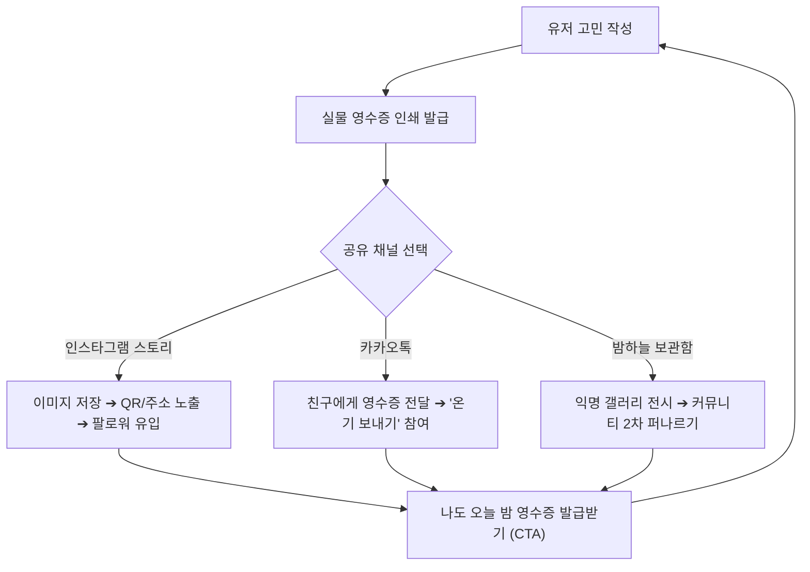

# ✧ 신비한 고민 상점의 영수증 - 바이럴 루프(Viral Loop) & 초기 성장 전략 가이드

> **대상 서비스**: 신비한 고민 상점의 영수증 (Mystic Worry Shop Receipt)  
> **핵심 과제**: 바이럴 루프 설계를 통한 초기 사용자 유입 및 오가닉 확산(Organic Spread) 가능성 분석  
> **작성 일자**: 2026년 10월

---

## 1. 성공 가능성 총평: "성공 잠재력 매우 높음 (High Potential)"

단순한 일회성 심리테스트를 넘어, **MZ세대의 힐링·자기이해 소비 트렌드**와 **SNS 공유에 가장 최적화된 시각적 폼팩터(영수증)**가 유기적으로 결합되어 있습니다.  
유료 광고비 집행 없이도 한 명의 유저가 1명 이상의 신규 유저를 데려오는 **바이럴 계수($K > 1$)**를 달성하기에 이상적인 구조입니다.

---

## 2. 왜 이 아이템이 바이럴에 강력한가? (3대 심리 트리거)

### ① 검증된 '영수증 폼팩터'의 시각적 파괴력
- **세로형 카드 비율(9:16)**: 인스타그램 스토리, 핀터레스트, 틱톡/릴스 등 모바일 피드에 잘림 없이 꽉 차게 들어맞습니다.
- **높은 완독률**: 텍스트가 길어도 "실제 영수증 종이"라는 익숙한 오브젝트 안에 담기면 사용자는 자연스럽게 품목 하나하나를 끝까지 정독하게 됩니다.
- **소비/성향 영수증의 흥행 계보**: '생각 과다 영수증', '빡침 영수증', '소비 영수증' 등 영수증 기반 콘텐츠는 이미 수백만 회 공유를 입증한 불패의 포맷입니다.

### ② "감정 청구 비용 0원 (대납 완료)"이 주는 강력한 카타르시스
- 기존 테스트들은 단순히 "당신은 이런 성향입니다"라는 진단으로 끝납니다.
- 본 서비스는 **"당신이 고민하느라 소모한 마음 에너지 780 kcal, 상점 주인이 전액 대납하여 0원 처리되었습니다"**라는 실질적인 **심리적 해방감(Emotional Catharsis)**을 선물합니다.
- 이 따뜻한 반전 포인트에서 유저들은 깊은 감동을 느끼며, **"나 위로받았다"는 자랑이자 치유의 의미로 자발적 공유**를 감행합니다.

### ③ 골든 아워(Golden Hour)와 타겟층의 완벽한 일치
- 취준생, 대학생, 사회초년생이 잠들기 전 잡생각과 불안에 시달리는 **새벽 11시 ~ 3시**에 가장 강력한 파괴력을 가집니다.
- "오늘 밤 당신의 짐은 이곳에 두고 가세요"라는 슬로건 자체가 새벽 감성을 정조준합니다.

---

## 3. 폭발적 확산을 만드는 3단계 바이럴 루프(Viral Loop) 아키텍처

### 🔁 Loop 1: 인스타그램 스토리 1초 저장 & 워터마크 루프
- **장치**: [영수증 이미지로 저장] 시, 영수증 최하단에 **"나도 마음의 짐 털어놓기 ➔ mystic-worry.shop"** 문구와 스캔 가능한 미니 QR코드가 자동으로 합성되어 저장됩니다.
- **유저 심리**: "나 요즘 이런 걸로 끙끙 앓았는데 위로받음", "내 마음 영수증 0원 실화냐 ㅠㅠ"
- **효과**: 팔로워들이 스토리를 보고 *"이거 어디서 해?"*를 물어볼 필요 없이 QR/주소로 즉각 유입됩니다.

### 🔁 Loop 2: 카카오톡 '온기(위로) 보내기' 친구 초대 루프
- 영수증 발급 후 카카오톡 공유 링크를 전송할 때, 일반 링크가 아닌 **'온기 배달 카드'**로 발송:
  > **💌 "지친 별빛 님이 신비한 고민 상점에 영수증을 남겼습니다. 친구의 마음에 따뜻한 온기(하트)를 보태어주세요!"**
- **상대방(친구)의 경험**:
  1. 링크를 열어 친구의 영수증과 처방전을 읽고 **[💛 온기 보내기]** 클릭 (하트 애니메이션 폭죽).
  2. 바로 아래에 대형 버튼 노출: **[🔮 나도 오늘 밤 고민 털어놓고 영수증 받기]**.
  3. 자연스럽게 다음 생산자(User)로 전환.

### 🔁 Loop 3: '밤하늘 보관함'을 통한 커뮤니티 2차 확산
- 유저들이 남긴 기상천외하거나 심금을 울리는 영수증(예: "신입사원 실수 영수증", "모태솔로 짝사랑 앓이 영수증")이 보관함에 아카이빙됩니다.
- 유저들이 재미있고 공감 가는 영수증을 캡처하여 **에브리타임, 블라인드, 인스티즈, X(트위터)**에 자발적으로 업로드하면서 2차 대규모 유입이 발생합니다.

---

## 4. 0명에서 10,000명 만드는 '콜드 스타트(Cold Start)' 마케팅 매뉴얼

마케팅 예산이 0원이어도 실행 가능한 오가닉(Organic) 3대 액션 플랜:

### 1) 인스타그램 릴스 & 틱톡 숏폼 영상 (가장 파급력 높은 치트키)
- **비주얼 구성**: 
  - 어두운 방, 조명 하나 켜둔 채 모니터에서 지지직- 소리와 함께 영수증이 슬라이드되어 출력되는 장면을 스마트폰으로 감성 촬영.
- **BGM**: 지브리 감성의 쓸쓸하지만 따뜻한 피아노 곡 또는 잔잔한 Lofi 음원.
- **자막 Hooking**:
  > *"요즘 밤마다 온갖 생각에 잠 못 드는 사람들을 위한 신비한 영수증 상점..."*  
  > *"내 모든 고민 청구서가 0원으로 탕감되는 순간"*
- **결과**: 공감형 릴스는 인스타그램 알고리즘 추천 탭을 타고 수만~수십만 뷰에 도달하기 가장 유리합니다.

### 2) 스레드(Threads) & X(트위터) 공감 텍스트 바이럴
- 스레드는 현재 감성/위로/공감 글의 도달률이 가장 높은 플랫폼입니다.
- **포스팅 예시**:
  > *"새벽에 이직 준비하다가 숨 막혀서 영수증 상점 가봤는데... 처방전 문구 보고 진짜 펑펑 욺... 오늘 밤 짐은 다 내려놓고 자라네..."* (영수증 캡처 이미지 첨부)
- 댓글에 접속 링크를 기재하여 트래픽 흡수.

### 3) 골든 타임 타겟팅 배포 (일요일 밤 10시 ~ 새벽 2시)
- 월요병이 극에 달하는 일요일 밤, 혹은 대학생 시험 기간, 대기업/공채 면접 시즌에 집중적으로 바이럴 시드(Seed)를 배포합니다.

---

## 5. 핵심 딜레마 극복: "금방 질리지 않을까?"에 대한 리텐션(Retention) 솔루션

### ⚠️ 문제 제기: "1회성 토이 앱의 리텐션 절벽"
실제로 대부분의 바이럴 심리테스트나 밈(Meme) 서비스들이 겪는 치명적인 문제는 **"Day 1 폭발적 바이럴 ➔ Day 7 리텐션 급락(이탈)"**입니다.  
현재처럼 단순한 `입력 ➔ 영수증 출력 ➔ 끝` 구조라면, 사용자는 2~3번 해보고 인스타그램에 올린 뒤 다시는 찾지 않는 **"1회성 장난감(One-off Toy)"**에 머무를 위험이 큽니다.

고민은 일회성이 아니라 매일 밤 새롭게 생겨납니다(면접, 인간관계, 야근, 번아웃 등).  
따라서 유저가 **질리지 않고 지속적으로 머물며 습관처럼 재방문하도록 만드는 5가지 핵심 리텐션 장치**를 구축해야 합니다.

---

### 🛡️ 질리지 않는 서비스를 만드는 5대 리텐션 엔진

#### 1) '고민 유통기한 알림 & 후속 정산서' (가장 강력한 재방문 트리거)
- **심리적 종결(Closure) 욕구 자극**:
  - 고민을 작성할 때 선택했던 유통기한(예: "3일 뒤", "한 달 뒤")이 지나면 웹 푸시 또는 알림톡이 발송됩니다:
    > *"3일 전 맡겨두셨던 [이직 면접 떨림] 영수증 기억하시나요? 상점 주인이 안부를 묻습니다."*
- **작동 메커니즘**:
  1. 링크를 열면 과거에 털어놓았던 영수증이 다시 열립니다.
  2. 질문 팝업: **[그때의 고민은 어떻게 되었나요?]** ➔ `[해결되었어요! 🌟]` / `[아직 조금 남아있어요 🍃]`
  3. '해결되었어요'를 누르면 영수증에 영롱한 골드 직인 스탬프 **`[ 해결 완료 / RESOLVED ]`**가 찍히며 마음 정산이 완료됩니다.
- **효과**: 사용자가 서비스를 완전히 잊고 있을 때 가장 자연스럽고 감동적인 명분으로 **재방문을 강제**합니다.

#### 2) '나만의 영수증 바인더 & 월간 고민 결산' (데이터 축적과 락인)
- **축적의 가치 (Investment)**:
  - 사용자는 자신의 기록과 데이터가 쌓이기 시작하면 절대로 앱을 이탈하지 않습니다.
  - 발급받은 영수증들이 빈티지 스크랩북처럼 차곡차곡 모여 "나만의 감정 성장 다이어리"가 됩니다.
- **월말 '마음 결산 리포트'**:
  - 매월 말일, 상점 주인이 한 달간의 정산서를 발행합니다:
    - *"이번 달 당신이 탕감받은 마음 에너지: 총 12,400 kcal"*
    - *"당신을 가장 괴롭혔던 감정 키워드 TOP 3: [조급함], [비교], [완벽주의]"*
    - *"상점 주인이 당신에게 전했던 마법 처방전 모아보기"*

#### 3) '밤하늘 우체통' : 익명 위로 답장 펜팔 (소셜 리텐션)
- 단순히 하트(온기)를 누르는 것에 그치지 않고, **30자 이내의 따뜻한 익명 쪽지(답장)**를 남길 수 있는 소셜 기능:
  - *"저도 작년에 같은 시험 준비하면서 많이 울었는데, 지나고 나면 다 괜찮아져요. 힘내요!"*
  - 내 영수증에 누군가 다정한 답장을 남겨주면 알림이 가고, 유저는 깊은 위로를 받으며 다시 접속합니다.
- **효과**: 일방향 테스트 서비스가 **"따뜻한 익명 커뮤니티/마음 약국"**으로 진화합니다.

#### 4) 게이미피케이션: '상점 확장 & 부적 도감'
- **성장 체감**: 털어낸 고민의 누적 무게(1kg, 10kg, 100kg...)에 따라 상점이 진화합니다.
  - `작은 촛불 텐트 ➔ 은은한 골목 상점 ➔ 별빛 쏟아지는 천문대`
- **변동 보상(Variable Reward)**: 영수증마다 발급되는 '행운의 부적 아이템'과 '행운의 색상'을 모으는 컬렉션 도감 제공.

#### 5) 상점 주인 '루미나'와의 1:1 심층 티타임 (AI 챗 확장)
- 영수증 발급 후 여운이 남은 유저를 위해 영수증 하단에 **[🍵 상점 주인과 조용한 티타임 가지기]** 버튼 제공.
- Gemini AI 상점 주인과 2~3턴 정도 조용히 대화를 더 나누며 속마음을 깊게 털어놓고 위안을 얻는 힐링 챗봇 모드로 유연하게 연결.

---

## 6. 전략적 2단계 진화 로드맵

| 단계 | 전략적 목표 | 프로덕트 형태 | 운영 핵심 |
| :---: | :---: | :---: | :---: |
| **Phase 1 (출시 초기)** | **초고속 바이럴 유입** | 지금의 **가볍고 심플한 실물 영수증** | 초기에 기능이 많고 복잡하면 이탈률이 급증합니다. **지금의 직관적이고 심플한 폼팩터가 인스타/스레드 바이럴에 최적의 무기**입니다. |
| **Phase 2 (출시 1~2주 후)** | **리텐션 & 락인(Lock-in)** | **유통기한 후속 알림 + 바인더 + 익명 답장** | 유입된 트래픽이 빠져나가지 않도록 재방문 장치들을 활성화하여 **영구적인 힐링 플랫폼/마음 일기**로 안착시킵니다. |

---

## 7. 지속 가능한 비즈니스 모델 (Monetization)

- **실물 굿즈 제작/배송**: 나의 영수증을 실제 감열지 스티커, 아크릴 키링, 패브릭 책갈피로 인쇄 배송.
- **B2B 힐링/사내 복지 연계**: 기업 사내 익명 고민 상담 부스, 대학교 축제 팝업 프로모션 연계.

---

## 8. 초기 무료 MVP 출시 시 예상 운영 비용 및 인프라 견적

### 💰 서비스 구성 요소별 비용 분석

#### ① AI API 비용 (추천 엔진: Google Gemini Flash)
- **무료 티어 (Free Tier)**:
  - **분당 15회 (15 RPM), 하루 최대 1,500회 (1,500 RPD)**까지 **완전 무료 (0원)** 제공.
  - 일일 영수증 발행 수 1,500장 미만 구간에서는 AI API 비용 **0원**.
- **유료 종량제 전환 시 (Pay-as-you-go)**:
  - 영수증 1장당 소모 토큰: 약 700 토큰 (입력 프롬프트 400 + 출력 JSON 300)
  - 영수증 1장당 비용: **약 $0.00012 (한화 약 0.16원)**
  - 영수증 1,000장 발행 시 ➔ **약 160원**
  - 영수증 10,000장 발행 시 ➔ **약 1,600원**

#### ② 백엔드 데이터베이스 (Supabase)
- **Free Plan**:
  - 데이터베이스 용량 500MB (텍스트/JSON 기준 **수십만 건의 영수증** 보관 가능)
  - 월간 활성 사용자(MAU) 50,000명까지 무료
  - **비용: 0원**

#### ③ 웹 호스팅 & 인프라 (Vercel 또는 Cloudflare Pages)
- **Hobby / Free Plan**:
  - 글로벌 CDN, SSL 인증서, 자동 빌드/배포 무료 지원
  - 월 100GB 대역폭 (월 수십만 페이지뷰 감당 가능)
  - **비용: 0원**

#### ④ 도메인 구매 (선택 사항)
- 초기에는 `mystic-worry.vercel.app` 무료 서브도메인 사용 시 **0원**
- 전용 독립 도메인(예: `worry-receipt.com` 또는 `.shop`) 연결 시: **연간 약 15,000원 ~ 20,000원**

---

### 📊 트래픽 규모별 월간 예상 비용 시뮬레이션

| 트래픽 규모 | 월간 영수증 발행 수 | AI API (Gemini) | Supabase DB | 호스팅 (Vercel) | **총 예상 월 비용** |
| :--- | :---: | :---: | :---: | :---: | :---: |
| **초기 런칭 (테스트 ~ 출시)** | 월 10,000건 이하 (일 약 300명) | **0원** (무료 티어 한도 내) | **0원** (무료) | **0원** (무료) | **0 원** |
| **소규모 바이럴 (초기 흥행)** | 월 50,000건 (일 약 1,600명) | **약 8,000원** | **0원** (무료) | **0원** (무료) | **약 8,000원** |
| **중대형 바이럴 (인스타/숏폼 떡상)** | 월 150,000건 (일 약 5,000명) | **약 24,000원** | **0원** (무료) | **0원** (무료) | **약 24,000원** |
| **초대박 바이럴 (월 50만 유입)** | 월 500,000건 (일 약 16,000명) | **약 80,000원** | $25 (약 34,000원, Pro 전환) | **0원** | **약 11만 원 내외** |

---

### 🛡️ 비용 폭탄 방지를 위한 안전장치 (MVP 필수 팁)

1. **클라이언트 쿨다운 (Rate Limiting)**:
   - 영수증 1회 발급 후 10~30초간 재발급 딜레이 적용.
   - 브라우저당 1일 최대 5~10회 발행 제한.
2. **동일 프롬프트 중복 방지 (Caching)**:
   - 같은 고민을 빠르게 연속 클릭했을 때 AI API 중복 호출 차단.
3. **Google Cloud 결제 한도 알림 (Budget Alert)**:
   - 구글 클라우드 콘솔에서 "월 $10 도달 시 이메일 알림"을 설정하여 예기치 않은 과금 사전 차단.

---

### 💡 결론
> **"MVP 런칭 및 초기 검증 단계에서는 0원으로 완벽하게 운영할 수 있으며, 인스타나 커뮤니티에서 폭발적으로 터져 수만 명이 유입되더라도 치킨 한 마리 값(1~2만 원대) 안에서 충분히 감당 가능합니다."**
